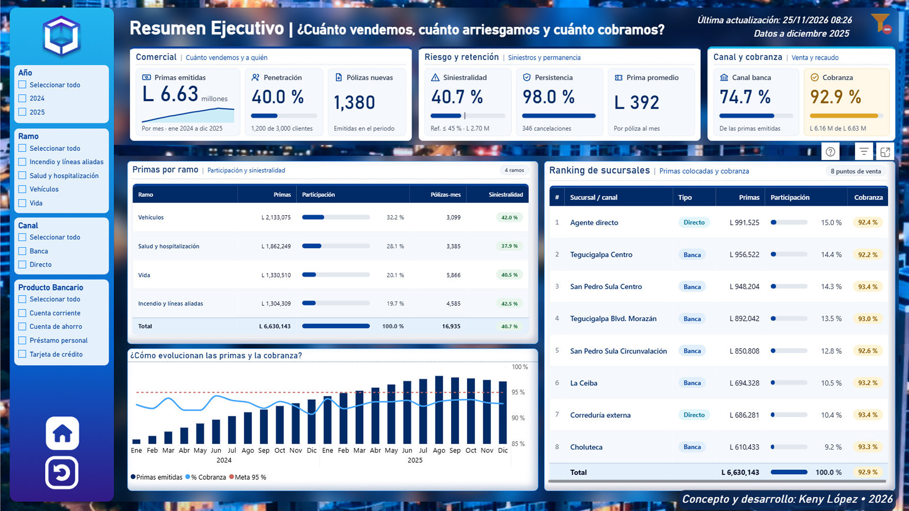

# 🩺 Pulso de Cartera de Seguros

### Venta, riesgo y cobranza de seguros vendidos a clientes del banco

🔗 **[Ver dashboard en Power BI](https://app.powerbi.com/view?r=eyJrIjoiM2FjYzY1MDUtNWIzMS00MGU5LWFiZTgtOTE3ZTJlOWQzNTE3IiwidCI6IjY4ODYzYjAyLTkxMDYtNDU2Yi1iYzFiLTEyNzRkMGZiZGJjYiIsImMiOjZ9)** · 📂 **[Caso de estudio en mi portafolio](https://sites.google.com/view/portafolio-keny-lpez/inicio)**

> ⚠️ **Datos sintéticos.** Generados en Python y calibrados con cifras públicas de la CNBS y la CAHDA. No corresponden a ninguna aseguradora ni banco real.

---

## 🎯 La pregunta de negocio

**¿Qué tan sana está la cartera de seguros que el banco vende a sus clientes?**

En la bancaseguros, el banco ofrece seguros a sus propios clientes. Para saber si el negocio está sano hay que mirar tres cosas al mismo tiempo:

| Pregunta | Qué se mide |
|---|---|
| 💰 ¿Cuánto vendemos? | Primas emitidas, penetración y pólizas nuevas |
| ⚖️ ¿Cuánto arriesgamos? | Siniestralidad, persistencia y prima promedio |
| 🧾 ¿Cuánto cobramos? | Cobranza y peso del canal banca |

El tablero cubre **3,000 clientes**, **1,380 pólizas** y **24 meses** (enero 2024 a diciembre 2025) en **8 puntos de venta**: 6 sucursales del banco y 2 canales directos.

---

## 🔍 Hallazgos principales

| Indicador | Resultado | Estado | Qué haría |
|---|---|---|---|
| **Penetración** | **40.0 %** — 1,800 de 3,000 clientes aún no tienen seguro | 🔵 Oportunidad | Priorizar la venta cruzada en clientes con préstamo o tarjeta |
| **Siniestralidad** | **40.7 %** — por debajo de la referencia de ~45 % del mercado hondureño | 🟢 Bajo control | Vigilar Incendio, el ramo más cercano a la referencia (42.5 %) |
| **Cobranza** | **92.9 %** — quedan **L 0.47 M** facturados sin cobrar | 🟡 Prioridad | Revisar el cobro automático: cargos rechazados y tarjetas vencidas |

💡 **Hallazgo clave:** la cobranza queda bajo la meta de 95 % en **24 de 24 meses** y en **8 de 8 puntos de venta**. El problema no es de una sucursal en particular: es del proceso de cobro, y la solución es central.

---

## 🖥️ Páginas del dashboard

| Página | Qué muestra |
|---|---|
| 🏠 [Portada](Dashboard1.png) | Nombre del proyecto, periodo, fecha de actualización y acceso al informe |
| 📖 [Acerca de](Dashboard2.png) | Propósito, los tres hallazgos con cifras calculadas del modelo y cómo está construido |
| 📊 [Resumen Ejecutivo](Dashboard3.png) | Panel de 8 indicadores con semáforo, tabla por ramo, evolución mensual de primas y cobranza, y ranking de sucursales |

---

## 📁 Contenido del repositorio

| Archivo | Contenido | Filas |
|---|---|---:|
| `Fact_BSGPolizas_Mensual.csv` | Una fila por póliza y por mes: estado, prima facturada, prima cobrada y siniestro pagado | 17,281 |
| `Dim_BSGCliente.csv` | Clientes del banco: edad, región, producto bancario base y antigüedad | 3,000 |
| `Dim_BSGProducto.csv` | Catálogo de seguros: ramo, tipo de cobertura y prima base mensual | 8 |
| `Dim_BSGCanal.csv` | Puntos de venta: 6 sucursales (Banca) y 2 canales directos | 8 |
| `Dim_BSGTiempo.csv` | Calendario diario de 2024 y 2025 | 731 |
| `Dashboard1.png` a `Dashboard3.png` | Capturas de las tres páginas del informe | — |

---

## 📐 Indicadores

Las **26 medidas DAX** viven en la tabla `_Medidas`, numeradas, agrupadas en carpetas por tema y comentadas con la pregunta de negocio que responden. Estos son los 8 indicadores del panel:

| Indicador | Qué mide, en palabras simples | Cálculo | Medida |
|---|---|---|---|
| 💰 Primas emitidas | Todo lo facturado por seguros: el volumen del negocio | Suma de la prima mensual de las pólizas activas | `01_Primas_Emitidas` |
| 🎯 Penetración | Qué parte de los clientes del banco tiene al menos un seguro | Clientes asegurados ÷ total de clientes | `06_Pct_Penetracion` |
| 🆕 Pólizas nuevas | Seguros vendidos por primera vez | Pólizas en su primer mes | `03_Polizas_Nuevas` |
| ⚖️ Siniestralidad | Qué parte de las primas se va en pagar reclamos | Siniestros pagados ÷ primas emitidas | `08_Pct_Siniestralidad` |
| 🔁 Persistencia | Si los clientes mantienen su seguro | 1 − cancelaciones ÷ pólizas activas del mes | `12_Pct_Persistencia_Mensual` |
| 🎫 Prima promedio | Cuánto paga en promedio cada póliza al mes | Primas emitidas ÷ pólizas-mes | `09_Prima_Promedio_Poliza` |
| 🏦 Canal banca | Qué parte de las primas se vende en sucursales | Primas del canal Banca ÷ primas totales | `14_Pct_Primas_Canal_Banca` |
| 🧾 Cobranza | Qué parte de lo facturado realmente se cobró | Primas cobradas ÷ primas facturadas | `16_Pct_Cobranza` |

**Carpetas de medidas:** 1. Comercial y penetración · 2. Rentabilidad y siniestralidad · 3. Persistencia · 4. Canal y cobranza · 5. HTML · 6. Textos

🚦 **Semáforo de tres niveles:** sin color cuando el indicador está dentro de lo esperado, ámbar cuando hay que vigilarlo y rojo cuando requiere atención. El panel y las tablas se construyeron con **HTML y CSS generados desde DAX** (visual HTML Content), así que responden a los filtros como cualquier visual nativo.

---

## 🧭 Decisiones y limitaciones

**Decisiones de diseño**

- 🔒 **Datos sintéticos:** los datos reales de pólizas y clientes son confidenciales; simularlos permite mostrar el método completo.
- 📊 **Calibración con cifras públicas:** la mezcla de ramos y la siniestralidad de referencia parten de publicaciones de la CNBS y la CAHDA.
- 🗓️ **Grano póliza-mes:** una sola tabla responde cuánto se vendió, cuánto se canceló y cuánto se cobró en cualquier periodo.
- 🌐 **GitHub como origen:** Power BI lee los CSV desde este repositorio; los datos quedan versionados y a la vista.

**Simplificaciones del demo**

- ⚖️ La siniestralidad se calcula como siniestros pagados ÷ primas emitidas. En la práctica se usan siniestros incurridos sobre prima devengada.
- 🔁 La persistencia es mensual. La industria suele medirla a 13 meses por cohorte de emisión.
- 🎚️ Los umbrales del semáforo (penetración 40 %, persistencia 97 % y 95 %, siniestralidad 50 %, cobranza 95 %) son supuestos del demo, no metas oficiales del sector.
- 📉 Las pólizas nuevas se simularon solo en los primeros 20 meses; por eso las primas bajan desde septiembre de 2025. Es un efecto de la simulación, no un hallazgo.
- 🗺️ La región del cliente y la sucursal se asignaron de forma independiente; por eso el informe filtra por producto bancario y no por región.
- 🎲 Qué clientes compran seguro se decidió al azar: un modelo predictivo sobre estos datos no encontraría patrones reales.

---

## 🚀 Siguiente fase

- 🌎 Dimensión de país para una vista regional, sin cambiar ninguna medida
- 🛡️ Catálogo de seguros masivos ligados a cada producto bancario
- 📆 Persistencia a 13 meses por cohorte
- 🤖 Modelo de propensión de compra en Python, con datos que tengan patrones reales
- 🏢 Página de detalle por sucursal

---

## 🤝 Uso de IA (Marco 4D)

Proyecto desarrollado en colaboración con **Claude (Anthropic)**:

- **Delegación:** generación de código Python, medidas DAX, HTML/CSS y documentación. Indicadores, supuestos, umbrales y diseño: del autor.
- **Descripción:** desarrollo iterativo con convenciones definidas por el autor: medidas numeradas, carpetas por tema y comentarios con la pregunta de negocio.
- **Discernimiento:** errores detectados y corregidos durante el desarrollo; por ejemplo, montos truncados por tipo de dato entero, una tabla de fechas mensual que no podía marcarse como tabla de fechas y afirmaciones que los datos no sostenían.
- **Diligencia:** cifras verificadas con consultas DAX contra el modelo, datos sintéticos declarados y simplificaciones documentadas, no ocultas.

---

## 👤 Autor

**Keny López** — Data Analyst & Business Intelligence · Tegucigalpa, Honduras

🎓 Microsoft Fabric Analytics Engineer (DP-700) · Power BI Data Analyst (PL-300)

